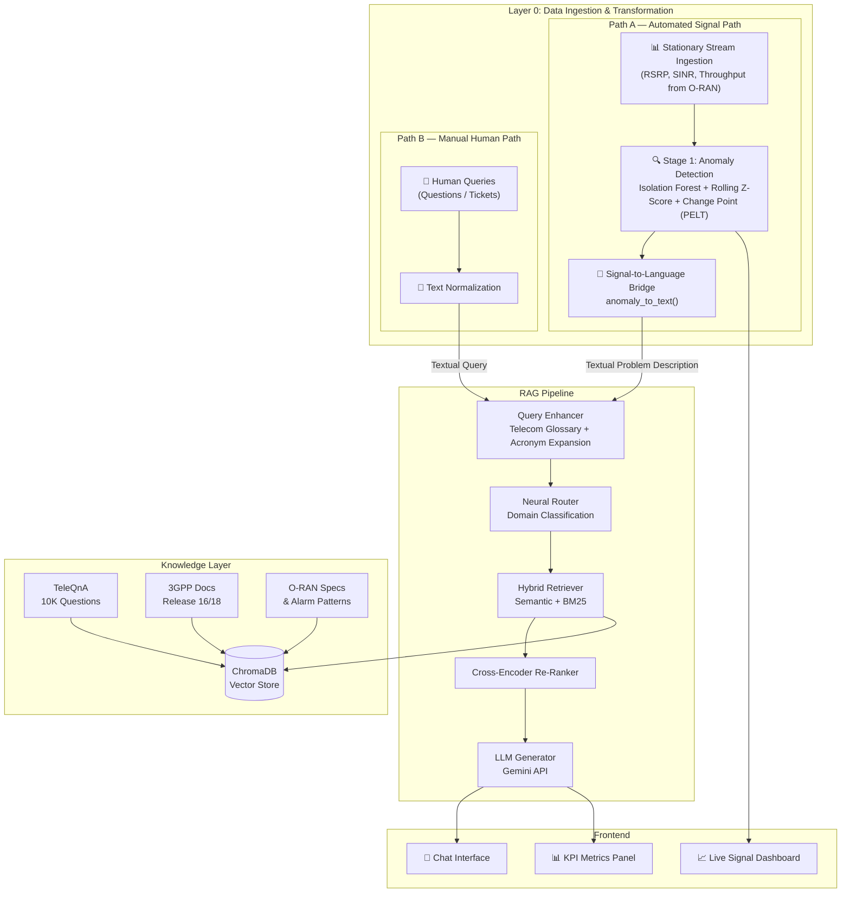

# Telecom RAG Application for RAN Tasks

Build a production-ready Retrieval-Augmented Generation (RAG) web application for telecom Radio Access Network tasks — including 3GPP spec Q&A, O-RAN knowledge retrieval, root cause analysis, and **live signal anomaly detection with signal-to-language conversion** — with a stunning UI and rigorous evaluation pipeline.

## User Review Required

> [!IMPORTANT]
> **LLM Backend Choice**: The architecture below uses the **Gemini API** (free tier via `google-generativeai`) as the generation backend, and **sentence-transformers** for local embeddings. If you prefer OpenAI, a local Ollama model, or a Hugging Face Tele-LLM model, let me know and I'll adjust.

> [!IMPORTANT]
> **GPU Availability**: The plan uses CPU-friendly components (ChromaDB, sentence-transformers `all-MiniLM-L6-v2`). If you have a CUDA-capable GPU, I can upgrade to larger embedding models (e.g., `BAAI/bge-large-en-v1.5`) and optionally integrate a local Tele-LLM for generation.

> [!WARNING]
> **Dataset Download**: The TeleQnA dataset (~10,000 questions) requires downloading a ZIP from GitHub and extracting with password `teleqnadataset`. The 3GPP knowledge base from Telco-RAG's `setup.py` also requires a download step. I'll automate these in the ingestion pipeline, but initial setup will take a few minutes.

## Open Questions

1. **Deployment target**: Is this for local demo only (localhost), or do you need Docker/cloud deployment?
2. **API Key**: Do you have a Gemini API key available, or should I set up a fully local pipeline with Ollama/Tele-LLMs?

---

## Architecture Overview — Dual Path

The system has **two input paths** that converge into a single RAG pipeline:

- **Path A (Automated)**: Numerical KPI streams → Anomaly Detection → Signal-to-Language Bridge → RAG
- **Path B (Manual)**: Human questions/tickets → Text Normalization → RAG



---

## Proposed Changes

### Component 1: Project Scaffolding & Configuration

Set up the full-stack project structure in a new `TelecomRAG` directory within the workspace.

#### [NEW] Project Structure
```
TelecomRAG/
├── backend/
│   ├── app/
│   │   ├── __init__.py
│   │   ├── main.py              # FastAPI app entry
│   │   ├── config.py            # Settings & env vars
│   │   ├── models.py            # Pydantic schemas
│   │   ├── routers/
│   │   │   ├── __init__.py
│   │   │   ├── chat.py          # Chat/query endpoint (Path B)
│   │   │   ├── signals.py       # Live signal ingestion & anomaly endpoint (Path A)
│   │   │   ├── evaluation.py    # Benchmark evaluation endpoint
│   │   │   └── ingest.py        # Data ingestion endpoint
│   │   ├── core/
│   │   │   ├── __init__.py
│   │   │   ├── embeddings.py    # Embedding model manager
│   │   │   ├── vectorstore.py   # ChromaDB interface
│   │   │   ├── retriever.py     # Hybrid retrieval logic
│   │   │   ├── reranker.py      # Cross-encoder re-ranking
│   │   │   ├── generator.py     # LLM generation (Gemini)
│   │   │   ├── router.py        # Neural query router
│   │   │   └── query_enhancer.py # Telecom query augmentation
│   │   ├── anomaly/                        # ← NEW: Signal anomaly module
│   │   │   ├── __init__.py
│   │   │   ├── stream_ingestion.py         # KPI stream receiver & buffer
│   │   │   ├── detectors.py               # Ensemble anomaly detection
│   │   │   ├── signal_to_language.py       # anomaly_to_text() bridge
│   │   │   └── simulator.py               # Synthetic KPI data generator
│   │   ├── ingestion/
│   │   │   ├── __init__.py
│   │   │   ├── teleqna_loader.py           # TeleQnA dataset loader
│   │   │   ├── document_chunker.py         # Section-aware chunking
│   │   │   └── oran_loader.py              # O-RAN data loader
│   │   └── evaluation/
│   │       ├── __init__.py
│   │       ├── metrics.py                  # MRR, Top-k, Accuracy, Recall, Faithfulness
│   │       └── benchmark.py                # TeleQnA benchmark runner
│   ├── data/                    # Downloaded datasets (gitignored)
│   ├── chroma_db/               # Persistent vector DB (gitignored)
│   ├── requirements.txt
│   └── .env.example
├── frontend/
│   ├── (Next.js project via create-next-app)
│   ├── src/
│   │   ├── app/
│   │   │   ├── layout.tsx
│   │   │   ├── page.tsx         # Main chat interface
│   │   │   └── globals.css
│   │   ├── components/
│   │   │   ├── ChatInterface.tsx
│   │   │   ├── MessageBubble.tsx
│   │   │   ├── SourcePanel.tsx
│   │   │   ├── SignalDashboard.tsx    # ← NEW: Live signal charts + alerts
│   │   │   ├── AnomalyAlert.tsx      # ← NEW: Anomaly notification cards
│   │   │   ├── MetricsDashboard.tsx
│   │   │   ├── Sidebar.tsx
│   │   │   └── Header.tsx
│   │   └── lib/
│   │       └── api.ts           # Backend API client
│   └── package.json
├── scripts/
│   ├── download_data.py         # Automated dataset downloader
│   └── run_benchmark.py         # CLI benchmark runner
├── .gitignore
└── README.md
```

---

### Component 2: Backend — Data Ingestion Pipeline

#### [NEW] [teleqna_loader.py](file:///c:/Users/K.S%20RAO/OneDrive/Desktop/Segmentation_Tasks/TelecomRAG/backend/app/ingestion/teleqna_loader.py)
- Download TeleQnA.zip from GitHub, extract with password `teleqnadataset`
- Parse the JSON dataset (10,000 MCQ questions across 5 categories)
- Transform each question into a document with metadata: `{question, options, answer, explanation, category}`
- Create two collections: **knowledge chunks** (from explanations/answers for retrieval) and **eval pairs** (for benchmarking)

#### [NEW] [document_chunker.py](file:///c:/Users/K.S%20RAO/OneDrive/Desktop/Segmentation_Tasks/TelecomRAG/backend/app/ingestion/document_chunker.py)
- Section-aware chunking for 3GPP-style documents
- Configurable chunk size (default 512 tokens) with 64-token overlap
- Metadata preservation: source document, section hierarchy, spec ID, release number
- Special handling for tables, numbered clauses, and cross-references

#### [NEW] [oran_loader.py](file:///c:/Users/K.S%20RAO/OneDrive/Desktop/Segmentation_Tasks/TelecomRAG/backend/app/ingestion/oran_loader.py)
- Load O-RAN specification summaries and terminology as additional knowledge base entries
- Build a telecom glossary for query augmentation

---

### Component 3: Backend — Anomaly Detection & Signal-to-Language (Path A)

This is the automated pipeline that processes live KPI streams, detects anomalies, and converts them into structured English text for the RAG system.

#### [NEW] [simulator.py](file:///c:/Users/K.S%20RAO/OneDrive/Desktop/Segmentation_Tasks/TelecomRAG/backend/app/anomaly/simulator.py)
Generates realistic synthetic KPI data for demo purposes:
- **Metrics simulated**: RSRP (dBm), RSRQ (dB), SINR (dB), Throughput (Mbps), Latency (ms), Handover Failure Count, Packet Loss (%)
- **Normal patterns**: Diurnal traffic cycles, small random variations around baseline
- **Injected anomalies**: Sudden drops (antenna fault), gradual degradation (interference), spike events (congestion), correlated multi-KPI failures (power outage)
- Output: Time-series DataFrame with `timestamp`, `cell_id`, and all KPI columns
- Configurable anomaly injection rate and types

#### [NEW] [stream_ingestion.py](file:///c:/Users/K.S%20RAO/OneDrive/Desktop/Segmentation_Tasks/TelecomRAG/backend/app/anomaly/stream_ingestion.py)
Receives and buffers KPI data streams:
- Accepts KPI data points via API or from the simulator
- Maintains a **sliding window buffer** (configurable, default 60 data points) per cell
- Stationarity check before feeding to detectors
- Emits windowed data to the detection ensemble

#### [NEW] [detectors.py](file:///c:/Users/K.S%20RAO/OneDrive/Desktop/Segmentation_Tasks/TelecomRAG/backend/app/anomaly/detectors.py)
**Ensemble anomaly detection** — runs 3 methods in parallel and uses voting:

| Detector | What It Catches | Library |
|---|---|---|
| **Rolling Z-Score** | Sudden spikes/drops in individual KPIs | `numpy` / `scipy` |
| **Isolation Forest** | Multi-dimensional outliers across correlated KPIs | `scikit-learn` |
| **Change Point Detection (PELT)** | Regime shifts — permanent behavioral changes | `ruptures` |

Each detector outputs:
```python
{
    "detector": "rolling_zscore",
    "is_anomaly": True,
    "metric": "RSRP",
    "cell_id": "Cell_42",
    "current_value": -118,
    "baseline_mean": -82,
    "baseline_std": 5.2,
    "score": 4.7,           # z-score or anomaly_score
    "timestamp": "2026-08-05T18:45:00",
    "window_data": [...],   # recent values for context
    "trend": "sharp_drop"   # sharp_drop | gradual_decay | spike | regime_shift
}
```

**Ensemble voting logic**:
- If **2/3 detectors** flag anomaly → confirmed anomaly (high confidence)
- If **1/3 detectors** flag → warning (medium confidence)
- Severity score = weighted average of individual scores

#### [NEW] [signal_to_language.py](file:///c:/Users/K.S%20RAO/OneDrive/Desktop/Segmentation_Tasks/TelecomRAG/backend/app/anomaly/signal_to_language.py)
The **`anomaly_to_text()`** bridge — converts mathematical anomaly data into structured English:

**Input** (from detectors):
```python
{
    "cell_id": "Cell_42",
    "timestamp_range": "18:45–18:52",
    "anomalies": [
        {"metric": "RSRP", "value": -118, "baseline": -82, "z_score": 4.7, "trend": "sharp_drop"},
        {"metric": "Throughput", "value": 3.1, "baseline": 45.2, "z_score": 5.1, "trend": "sharp_drop"},
        {"metric": "Handover_Failures", "value": 7, "baseline": 0.2, "z_score": 8.5, "trend": "spike"}
    ],
    "ensemble_confidence": "high",
    "detectors_agreed": 3
}
```

**Output** (structured English text — becomes the RAG query):
```
ANOMALY REPORT — Cell_42 [18:45–18:52] — HIGH CONFIDENCE (3/3 detectors)

Signal Analysis:
• RSRP dropped sharply from baseline -82 dBm to -118 dBm (Δ = -36 dB, Z-score: 4.7)
• Throughput degraded from 45.2 Mbps to 3.1 Mbps (93% reduction, Z-score: 5.1)
• Handover failures spiked from 0.2/min to 7/min (35x increase, Z-score: 8.5)

Pattern: Correlated multi-KPI degradation with sudden onset.
All three metrics degraded simultaneously, suggesting a single root cause
rather than independent failures.

Query for RAG: What are the possible root causes when a cell simultaneously
experiences sharp RSRP drop (-36 dB), throughput degradation (93%), and
handover failure spike (35x) with sudden onset?
```

**Key features of the bridge**:
- Template-based text generation (no LLM needed — deterministic and fast)
- Computes deltas, percentage changes, and severity descriptions
- Detects **co-occurrence patterns** (which metrics broke together)
- Classifies anomaly pattern: `isolated_spike`, `correlated_degradation`, `gradual_decay`, `regime_shift`
- Generates a **focused RAG query** from the anomaly context

---

### Component 4: Backend — RAG Core Engine

#### [NEW] [embeddings.py](file:///c:/Users/K.S%20RAO/OneDrive/Desktop/Segmentation_Tasks/TelecomRAG/backend/app/core/embeddings.py)
- Use `sentence-transformers/all-MiniLM-L6-v2` (lightweight, CPU-friendly, 384-dim)
- Singleton pattern for model loading to minimize RAM
- Batch embedding support for ingestion performance

#### [NEW] [vectorstore.py](file:///c:/Users/K.S%20RAO/OneDrive/Desktop/Segmentation_Tasks/TelecomRAG/backend/app/core/vectorstore.py)
- ChromaDB with persistent storage
- Multiple collections: `teleqna_knowledge`, `3gpp_specs`, `oran_docs`, `telecom_glossary`
- Metadata filtering by category, spec_id, release_number

#### [NEW] [retriever.py](file:///c:/Users/K.S%20RAO/OneDrive/Desktop/Segmentation_Tasks/TelecomRAG/backend/app/core/retriever.py)
- **Hybrid retrieval**: Combine semantic search (vector similarity) with keyword search (BM25)
- Configurable top-k (default k=10 for retrieval, k=5 after re-ranking)
- Collection routing based on query classification

#### [NEW] [reranker.py](file:///c:/Users/K.S%20RAO/OneDrive/Desktop/Segmentation_Tasks/TelecomRAG/backend/app/core/reranker.py)
- Cross-encoder re-ranking using `cross-encoder/ms-marco-MiniLM-L-6-v2`
- Re-scores and reorders retrieved documents by relevance to query
- Critical for improving MRR and Top-k accuracy targets

#### [NEW] [query_enhancer.py](file:///c:/Users/K.S%20RAO/OneDrive/Desktop/Segmentation_Tasks/TelecomRAG/backend/app/core/query_enhancer.py)
- Telecom glossary expansion (e.g., "gNB" → "gNB (Next Generation Node B)")
- Acronym detection and expansion for 3GPP terminology
- Multi-query generation for complex questions (decompose into sub-queries)
- Handles **both** Path A (anomaly text) and Path B (human queries) as input

#### [NEW] [router.py](file:///c:/Users/K.S%20RAO/OneDrive/Desktop/Segmentation_Tasks/TelecomRAG/backend/app/core/router.py)
- Classify queries into domains: `3gpp_specs`, `oran`, `general_telecom`, `rca` (root cause analysis), `anomaly`
- Keyword + semantic classification approach
- Route to appropriate collection(s) and retrieval strategy
- **Anomaly-originated queries** are automatically routed to `oran_docs` + `3gpp_specs` for troubleshooting context

#### [NEW] [generator.py](file:///c:/Users/K.S%20RAO/OneDrive/Desktop/Segmentation_Tasks/TelecomRAG/backend/app/core/generator.py)
- Gemini API integration with structured prompting
- Domain-specific system prompt for telecom expert persona
- Source citation injection (reference retrieved chunks with IDs)
- Chain-of-thought prompting for multi-step reasoning (RCA use cases)
- Faithfulness enforcement: constrain answers to retrieved context
- **Anomaly mode**: When input is from Path A, the prompt includes the signal context and asks for root cause diagnosis + recommended actions

---

### Component 5: Backend — Evaluation Engine

#### [NEW] [metrics.py](file:///c:/Users/K.S%20RAO/OneDrive/Desktop/Segmentation_Tasks/TelecomRAG/backend/app/evaluation/metrics.py)
Compute all target KPIs:

| Metric | Implementation | Target |
|--------|---------------|--------|
| MRR | Mean Reciprocal Rank of correct answer in retrieved candidates | > 75% |
| Top-k Accuracy | Correct answer present in top-k retrieved docs | > 85% |
| Accuracy | Exact match of generated answer vs ground truth | > 80% |
| Recall | Relevant documents retrieved / total relevant | > 85% |
| Faithfulness | Generated answer grounded in retrieved context (LLM-judge) | > 90% |

#### [NEW] [benchmark.py](file:///c:/Users/K.S%20RAO/OneDrive/Desktop/Segmentation_Tasks/TelecomRAG/backend/app/evaluation/benchmark.py)
- Run TeleQnA benchmark: iterate through dataset questions, retrieve, generate, compare
- Category-level breakdown of metrics
- Export results as JSON + display in dashboard

---

### Component 6: Backend — FastAPI Server

#### [NEW] [main.py](file:///c:/Users/K.S%20RAO/OneDrive/Desktop/Segmentation_Tasks/TelecomRAG/backend/app/main.py)
- FastAPI app with CORS middleware
- Startup event: load models, connect to vector store, start signal simulator (background task)
- Health check endpoint

#### [NEW] [chat.py](file:///c:/Users/K.S%20RAO/OneDrive/Desktop/Segmentation_Tasks/TelecomRAG/backend/app/routers/chat.py) — Path B
- `POST /api/chat` — Main query endpoint for human questions
  - Input: `{query: string, session_id?: string, mode: "qa" | "rca"}`
  - Output: `{answer: string, sources: [{text, document, score}], reasoning_chain: string[], confidence: float}`
- `GET /api/chat/history/{session_id}` — Conversation history

#### [NEW] [signals.py](file:///c:/Users/K.S%20RAO/OneDrive/Desktop/Segmentation_Tasks/TelecomRAG/backend/app/routers/signals.py) — Path A
- `POST /api/signals/ingest` — Receive KPI data points (or start simulator)
- `GET /api/signals/stream` — **SSE (Server-Sent Events)** endpoint for live signal data to frontend
- `GET /api/signals/anomalies` — Get recent detected anomalies with textual descriptions
- `GET /api/signals/anomalies/{id}/diagnose` — Trigger RAG diagnosis for a specific anomaly
  - Runs: anomaly_to_text() → query_enhancer → retriever → reranker → generator
  - Output: `{anomaly_report: string, diagnosis: string, sources: [...], recommended_actions: string[]}`
- `POST /api/signals/simulate/start` — Start/stop the synthetic data simulator
- `GET /api/signals/status` — Current signal monitoring status

#### [NEW] [evaluation.py](file:///c:/Users/K.S%20RAO/OneDrive/Desktop/Segmentation_Tasks/TelecomRAG/backend/app/routers/evaluation.py)
- `POST /api/evaluate/run` — Trigger benchmark run
- `GET /api/evaluate/results` — Get latest evaluation metrics
- `GET /api/evaluate/status` — Check benchmark progress

#### [NEW] [ingest.py](file:///c:/Users/K.S%20RAO/OneDrive/Desktop/Segmentation_Tasks/TelecomRAG/backend/app/routers/ingest.py)
- `POST /api/ingest/teleqna` — Ingest TeleQnA dataset
- `POST /api/ingest/documents` — Upload and ingest custom documents
- `GET /api/ingest/status` — Check ingestion progress

---

### Component 7: Frontend — Premium Next.js UI

A stunning, dark-mode-first web interface with glassmorphism effects, inspired by modern AI chat applications.

#### Design System
- **Color palette**: Deep navy (#0A0F1C) base, electric blue (#3B82F6) accents, cyan (#06B6D4) highlights, purple (#8B5CF6) secondary, red (#EF4444) for anomaly alerts
- **Typography**: Inter font family, clean hierarchy
- **Effects**: Glassmorphism panels, subtle glow effects, smooth transitions
- **Layout**: 3-column: Sidebar | Chat/Signal View | Source Panel (collapsible)

#### [NEW] ChatInterface.tsx — Path B UI
- Full-featured chat with streaming response display
- Mode selector: "3GPP Q&A", "Root Cause Analysis", "General Telecom"
- Message history with search
- Loading states with skeleton animations

#### [NEW] SignalDashboard.tsx — Path A UI
- **Real-time charts** (using Recharts/Chart.js) showing KPI streams per cell
- Line charts for RSRP, SINR, Throughput with anomaly regions highlighted in red
- Cell selector dropdown
- Signal status indicators (normal/warning/critical)
- Auto-scrolling time axis

#### [NEW] AnomalyAlert.tsx — Path A Notifications
- Toast-style alert cards that pop up when anomalies are detected
- Shows: cell ID, affected metrics, severity badge, timestamp
- "Diagnose" button → triggers RAG analysis → shows diagnosis inline
- Expandable to show full anomaly_to_text() output
- Color-coded by severity (yellow=warning, red=critical)

#### [NEW] MessageBubble.tsx
- User/Assistant message rendering with markdown support
- Source citation chips (clickable, expand to show context)
- Confidence indicator bar
- Reasoning chain expandable section

#### [NEW] SourcePanel.tsx
- Side panel showing retrieved documents for current query
- Relevance score visualization (progress bars)
- Document metadata display (source, category, spec ID)
- Highlight matching text segments

#### [NEW] MetricsDashboard.tsx
- KPI cards with animated counters (MRR, Accuracy, Recall, Faithfulness)
- Category-level performance breakdown chart
- Anomaly detection stats: total detected, diagnosed, false positive rate
- Benchmark history timeline

#### [NEW] Sidebar.tsx
- Navigation: Chat (Path B), Signal Monitor (Path A), Dashboard, Settings
- Session history list
- System status indicators (DB connected, models loaded, simulator running)
- Dataset statistics

#### [NEW] Header.tsx
- App branding with animated gradient logo
- Quick settings: API key input, model selection
- Live anomaly count badge (red dot with count)
- System notifications

---

### Component 8: Security & Privacy

- **API key management**: Keys stored in `.env`, never exposed to frontend
- **Input sanitization**: All user queries sanitized before processing
- **No PII logging**: Query logs exclude personally identifiable information
- **Signal data isolation**: KPI data processed in-memory, not persisted beyond buffer window
- **Rate limiting**: FastAPI rate limiter to prevent abuse
- **CORS configuration**: Restrict origins in production

---

## End-to-End Flow Examples

### Flow 1: User Asks a 3GPP Question (Path B)
```
User types: "What is the role of SSB in 5G NR initial access?"
  → Text Normalization → Query Enhancement (expand SSB, NR)
  → Router classifies: 3gpp_specs
  → Retriever: search 3gpp_specs + teleqna_knowledge collections
  → Re-Ranker: top 5 most relevant chunks
  → Generator: Gemini produces answer citing 3GPP TS 38.213
  → Frontend: shows answer + source panel with citations
```

### Flow 2: Anomaly Auto-Detected (Path A)
```
Simulator generates: Cell_42 RSRP drops from -82 to -118 dBm
  → Stream Ingestion buffers 60 data points
  → Detectors run: Z-Score=4.7, IF=0.92, PELT=changepoint detected
  → Ensemble: 3/3 agree → HIGH confidence anomaly
  → signal_to_language: generates structured English report
  → Frontend: red alert pops up on Signal Dashboard
  → User clicks "Diagnose"
  → anomaly text → Query Enhancement → Router (→ oran + 3gpp)
  → Retriever → Re-Ranker → Generator
  → Frontend: shows diagnosis with root causes + recommended actions + sources
```

---

## Verification Plan

### Automated Tests

1. **Backend unit tests**:
   ```bash
   cd TelecomRAG/backend && python -m pytest tests/ -v
   ```
   - Test ingestion pipeline (TeleQnA loader, chunker)
   - Test anomaly detectors with known anomalous data
   - Test signal_to_language output format
   - Test retrieval accuracy with known queries
   - Test evaluation metrics computation

2. **TeleQnA Benchmark**:
   ```bash
   cd TelecomRAG && python scripts/run_benchmark.py --subset 100
   ```
   - Run on a subset of 100 questions first, then full dataset
   - Verify KPIs meet targets:
     - MRR > 75%, Top-k > 85%, Accuracy > 80%, Recall > 85%, Faithfulness > 90%

3. **Anomaly Detection Validation**:
   ```bash
   cd TelecomRAG && python -m pytest tests/test_anomaly.py -v
   ```
   - Inject known anomalies into synthetic data
   - Verify all 3 detectors flag them correctly
   - Verify signal_to_language produces valid, parseable text
   - Verify end-to-end: anomaly → text → RAG → diagnosis

4. **Frontend build check**:
   ```bash
   cd TelecomRAG/frontend && npm run build
   ```

5. **End-to-end test via browser**:
   - Launch backend + frontend
   - Test Path B: Submit Q&A queries through chat UI
   - Test Path A: Start simulator, watch anomalies appear on signal dashboard, click "Diagnose"
   - Verify source citations appear correctly
   - Check metrics dashboard displays results

### Manual Verification
- Visual inspection of the UI for design quality
- Test Path B with various telecom questions
- Test Path A: watch the signal dashboard, verify anomaly alerts fire correctly
- Verify source attribution accuracy
